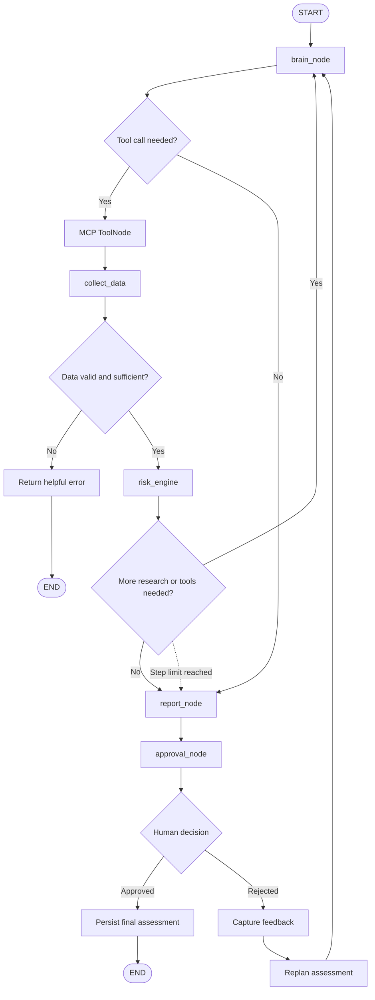

# StockMarket (StockSense)


An agentic investment assessment assistant for Indian and international stocks. Describe a company or compare multiple stocks, choose a risk profile and holding horizon, and StockSense gathers market data, evaluates risk fit and return potential using deterministic analysis engines, and generates a report for human approval.

After approval, you can ask follow-up questions about the saved assessment.

<p align="center">
  
</p>

> **Disclaimer:** StockSense is a research and educational analysis tool, not financial advice. Market data and news may be delayed, incomplete, or unavailable. Investment signals are analytical outputs, not guarantees of future performance.

---

## Table of Contents

- [Features](#features)
- [LangGraph Workflow](#langgraph-workflow)
- [Shared State — AssessmentState](#shared-state--assessmentstate)
- [Architecture](#architecture)
- [Technology Stack](#technology-stack)
- [Prerequisites](#prerequisites)
- [Installation and Setup](#installation-and-setup)
- [Environment Variables](#environment-variables)
- [Running the Project](#running-the-project)
- [HTTP API](#http-api)
- [MCP Tools](#mcp-tools)
- [Project Structure](#project-structure)
- [Testing](#testing)
- [Reports and Persistence](#reports-and-persistence)
- [Limitations](#limitations)

---

## Features

### Agentic Research
- Uses an LLM-powered LangGraph agent to interpret investment requests.
- Plans research steps and decides when to call external tools.
- Supports iterative tool calls to gather additional evidence.
- Resolves company names into relevant exchange tickers.
- Supports single-stock assessments and multi-stock comparisons.

### Market Data and Research
- Retrieves historical market prices and price-derived metrics.
- Fetches company fundamentals.
- Searches company-specific and general market news.
- Integrates external data through a Model Context Protocol (MCP) server.

### Deterministic Financial Analysis
- Calculates financial risk and return metrics using Python analysis engines.
- Evaluates risk fit against the user's investment profile.
- Evaluates relative return potential.
- Produces a BUY, WATCH, or AVOID signal according to the implemented assessment rules.
- Keeps quantitative analysis separate from LLM-generated explanations.

### Reports and Human Approval
- Generates Markdown (`.md`) and structured JSON (`.json`) assessment reports.
- Saves reports to the filesystem.
- Persists assessment records in PostgreSQL.
- Supports human approval or rejection of assessments.
- Allows feedback-driven replanning when an assessment is rejected.
- Supports follow-up questions about saved reports.

### Workflow Reliability
- Uses conditional routing and tool-call guardrails.
- Validates inputs and handles missing or invalid data.
- Supports resumable LangGraph workflows through checkpointing when configured.
- Maintains assessment status, tool results, and report metadata.

---

## LangGraph Workflow

The following diagram describes the intended high-level flow of the assessment graph.



### Workflow Explanation

1. **`brain_node`** — Interprets the user request, risk profile, holding horizon, and assessment objective. It decides which research steps or tool calls are required.

2. **MCP ToolNode** — Invokes the available MCP tools to resolve tickers and retrieve market prices, fundamentals, and news.

3. **`collect_data`** — Collects and organizes tool outputs for downstream analysis.

4. **Validation and guardrails** — Check whether the required inputs and market data are usable. Invalid or insufficient data should produce a clear error rather than a misleading assessment.

5. **`risk_engine`** — Calculates quantitative risk and return metrics and applies deterministic assessment rules.

6. **Conditional routing** — Determines whether additional research is needed or whether the assessment can proceed to report generation. Tool loops should remain bounded.

7. **`report_node`** — Combines quantitative results and research findings into Markdown and JSON reports.

8. **`approval_node`** — Pauses the workflow for human review and an approval or rejection decision.

9. **Persistence and completion** — Saves the final assessment and returns the result. A rejected assessment can feed back into another planning pass, according to the implemented graph logic.

> The Mermaid diagram is a high-level representation. Keep its node names and conditional edges synchronized with the actual graph implementation in `chat/workflow.py`.

---

## Shared State — AssessmentState

LangGraph nodes exchange information through a shared state object. The state holds the original request, research evidence, quantitative analysis, report artifacts, and approval information.

The following fields are documented for this project:

| Field | Purpose |
|---|---|
| `query` | Original investment question or request |
| `profile` | Risk profile selected by the user |
| `horizon` | Investment holding horizon |
| `messages` | Conversation and tool-call messages |
| `tickers` | Stock symbols involved in the assessment |
| `price_data` | Historical market price data |
| `fundamentals` | Company fundamental information |
| `news` | Retrieved news and research evidence |
| `risk_results` | Deterministic risk analysis results |
| `return_results` | Return potential analysis results |
| `verdict` | Assessment verdict or signal |
| `report_markdown` | Generated Markdown report content |
| `report_json` | Structured JSON report content |
| `assessment_id` | Persisted assessment identifier |
| `approval_status` | Current approval status |
| `approval_comment` | Human feedback or rejection comment |
| `errors` | Validation, tool, or workflow errors |

These names should match the actual `AssessmentState` definition in the source code. Do not rename state fields in the documentation without updating the implementation.

### State Lifecycle

```text
User Request
    |
    v
Request + Preferences
    |
    v
Messages + Tool Calls + Tool Results
    |
    v
Prices + Fundamentals + News
    |
    v
Risk Results + Return Results + Verdict
    |
    v
Markdown + JSON Report
    |
    v
Approval Status + Feedback
    |
    v
Persisted Assessment + Final Response
```

---

## Architecture

```text
                    User / Frontend / CLI
                             |
                             v
                       FastAPI (api.py)
                             |
                             v
                     LangGraph Workflow
                         (chat/)
                             |
                 +-----------+-----------+
                 |                       |
                 v                       v
          LLM Planning Agent         MCP Server
                 |                       |
                 |                 +-----+------+
                 |                 |     |      |
                 |                 v     v      v
                 |              Ticker Prices Fundamentals
                 |                       |
                 |                    News Search
                 |                       |
                 +-----------+-----------+
                             |
                             v
                       Data Collection
                             |
                             v
                   Deterministic Analysis
                     (analysis/)
                             |
                             v
                    Report Generation
                       (report/)
                             |
                             v
                      Human Approval
                             |
                  +----------+----------+
                  |                     |
               Approved              Rejected
                  |                     |
                  v                     v
              Persistence           Replanning
                  |
                  v
           Final Assessment
                  |
                  v
          Report Follow-up Q&A
```

### Main Components

- **FastAPI:** Exposes the assessment and follow-up endpoints.
- **LangGraph:** Orchestrates planning, tool use, conditional routing, approval, and workflow continuation.
- **LLM providers:** Groq is used for agent planning/research, while Google Gemini is used for report Q&A, according to the current configuration.
- **MCP server:** Exposes market-data and research tools to the agent.
- **Analysis engines:** Calculate quantitative risk and return measures independently of the LLM.
- **PostgreSQL:** Stores assessment records and supports graph checkpointing when configured.
- **Filesystem:** Stores generated Markdown and JSON reports.

---

## Technology Stack

| Component | Technology |
|---|---|
| Language | Python 3.12+ |
| Dependency management | uv |
| API | FastAPI |
| Agent orchestration | LangGraph |
| LLM for planning/research | Groq |
| LLM for report Q&A | Google Gemini |
| Tool integration | Model Context Protocol (MCP) |
| Market data | Yahoo Finance and configured data tools |
| News research | Configured news/search tools |
| Analysis | Python financial analysis engines |
| Persistence | PostgreSQL |
| Testing | pytest |

---

## Prerequisites

Before running the project, install or configure:

- Python 3.12 or later
- [uv](https://docs.astral.sh/uv/)
- PostgreSQL
- A Groq API key
- A Google Gemini API key
- Access to the configured MCP server, or the ability to run it locally

---

## Installation and Setup

Clone the repository:

```bash
git clone https://github.com/prashantoptimus0588/StockMarket.git
cd StockMarket
```

Install the dependencies:

```bash
uv sync
```

Create your environment file.

**Windows PowerShell:**

```powershell
Copy-Item .env.example .env
```

**Linux/macOS:**

```bash
cp .env.example .env
```

Update `.env` with your credentials and service configuration.

Do not commit `.env` or expose API keys in source control.

### Initialize PostgreSQL

If the repository's initialization module is `database/init_db.py`, run:

```bash
uv run python -m database.init_db
```

Check the actual module filename in your repository if this command does not match the current database initialization code.

---

## Environment Variables

The following variables are used by the project configuration. Confirm their defaults in `.env.example` before running the application.

| Variable | Purpose |
|---|---|
| `MCP_SERVER_URL` | MCP server endpoint, such as `http://localhost:8001/mcp` |
| `DATABASE_URL` | PostgreSQL connection URL |
| `GROQ_API_KEY` | API key for the agent/research LLM |
| `GOOGLE_API_KEY` | API key for the Gemini Q&A model |
| `AGENT_MODEL` | Configures the agent model; the documented default is `openai/gpt-oss-120b` |
| `QNA_MODEL` | Configures the report Q&A model; the documented default is `gemini-3-flash-preview` |
| `CORS_ORIGINS` | Allowed frontend origins |
| `HOST` | API bind address |
| `PORT` | API port |
| `ALLOW_MEMORY_FALLBACK` | Allows an in-memory checkpointer if configured and PostgreSQL is unavailable |
| `LANGSMITH_*` | Optional tracing configuration |

For a local MCP server, configure the MCP URL to match its actual host, port, and transport endpoint. For a deployed server, use the deployed endpoint.

For PostgreSQL providers that require SSL, configure the connection URL with the appropriate SSL settings.

---

## Running the Project

Run the MCP server and FastAPI application as separate processes when using a locally hosted MCP server.

### 1. Start the MCP Server

**Windows PowerShell:**

```powershell
$env:PORT = "8001"
uv run python mcp-server/server.py
```

**Linux/macOS:**

```bash
PORT=8001 uv run python mcp-server/server.py
```

Use the actual entry-point filename in your repository if it differs.

### 2. Start the FastAPI Application

In another terminal:

```bash
uv run python api.py
```

If the application exposes the FastAPI instance as `app` in `api.py`, you can also run:

```bash
uv run uvicorn api:app --host 127.0.0.1 --port 8000
```

### 3. Check API Health

```text
GET http://127.0.0.1:8000/health
```

The health endpoint reports the runtime status and, according to the current API documentation, discovered MCP tools.

### 4. Run the CLI

```bash
uv run python -m chat.chat
```

The CLI accepts an investment question and collects the relevant risk profile and holding horizon.

---

## HTTP API

Base URL:

```text
http://127.0.0.1:8000
```

| Method | Endpoint | Purpose |
|---|---|---|
| `GET` | `/health` | Check runtime status and discovered MCP tools |
| `POST` | `/assessments` | Start an assessment |
| `POST` | `/assessments/stream` | Stream assessment progress using SSE |
| `GET` | `/assessments/{thread_id}` | Retrieve assessment status or report |
| `POST` | `/assessments/{thread_id}/decision` | Submit an approval or rejection decision |
| `POST` | `/assessments/{thread_id}/qna` | Ask a follow-up question about a saved report |

### Example Assessment Request

```json
{
  "query": "Analyze Maruti Suzuki. Look up its ticker, price trend, fundamentals, and recent news.",
  "profile": "balanced",
  "horizon": "long"
}
```

Supported risk profiles:

- `aggressive`
- `balanced`
- `conservative`

Supported investment horizons:

- `short`
- `medium`
- `long`

An assessment request can cover up to four tickers, according to the documented API constraints.

### Human Approval

The decision endpoint accepts an approval or rejection decision, optionally with a comment.

The exact request schema should match the Pydantic model used by the current API implementation.

### Follow-up Questions

The Q&A endpoint lets the user ask questions about the saved assessment, such as requesting clarification of the risk metrics, verdict, or report findings.

---

## MCP Tools

The active market and research tools documented for the project are:

| Tool | Required | Purpose |
|---|---|---|
| `search_ticker` | Yes | Resolve company names into listing candidates |
| `getStock_price_info` | Yes | Retrieve historical OHLCV prices and price-derived metrics |
| `getStock_fundamentals` | Yes | Retrieve valuation, profitability, debt, and related fundamentals |
| `get_stock_news` | Optional | Retrieve company-specific headlines |
| `get_general_news` | Optional | Retrieve sector or topic headlines |
| `get_weather` | Demo / optional | Placeholder weather tool, if retained in the current server |

The agent uses the available MCP tools to gather evidence for the assessment. The exact tool names must match the MCP server's registered tool definitions.

**Backtesting is not listed as an active MCP capability in this README.**

Indian listings commonly use exchange suffixes, such as `RELIANCE.NS` and `TCS.BO`. US tickers are typically unsuffixed, such as `AAPL`.

---

## Project Structure

The following is a high-level map of the main project components. Adjust individual filenames to match the current repository.

```text
StockMarket/
├── api.py
├── chat/
│   ├── chat.py
│   ├── workflow.py
│   ├── assessment_logic.py
│   ├── llm_utils.py
│   └── config.py
├── mcp-server/
│   └── server.py
├── analysis/
│   ├── risk engine modules
│   └── return engine modules
├── database/
│   ├── connection.py
│   ├── models.py
│   ├── repository.py
│   └── init_db.py
├── models/
├── report/
├── reports/
│   ├── markdown/
│   └── json/
├── test/
├── .env.example
├── .gitignore
├── pyproject.toml
├── uv.lock
└── README.md
```

### Important Modules

- `api.py` — FastAPI application and HTTP endpoints.
- `chat/chat.py` — Agent runtime and CLI interaction.
- `chat/workflow.py` — LangGraph graph definition and routing.
- `chat/assessment_logic.py` — Assessment rules and workflow guardrails.
- `chat/llm_utils.py` — LLM provider utilities.
- `chat/config.py` — Runtime configuration, timeouts, and tool names.
- `mcp-server/server.py` — MCP server and tool definitions.
- `analysis/` — Deterministic risk and return calculations.
- `database/` — PostgreSQL connection, models, repository, and initialization.
- `report/` — Markdown and JSON report generation.
- `reports/` — Generated report artifacts.

Refer to `REFACTORING.md` if present for more details on the module boundaries.

---

## Testing

Run the project tests using pytest:

```bash
uv run pytest
```

To run selected analysis and repository tests:

```bash
uv run pytest analysis/test_risk_engine.py analysis/test_return_engine.py test/test_repository.py
```

Test filenames can vary as the project evolves. Use the actual paths in your repository.

### Testing Notes

- Pure Python risk and return tests should not require live market-data access.
- Repository tests require a configured database.
- MCP integration tests may require network connectivity and valid service configuration.
- LLM integration tests may require API credentials and can incur API usage.
- Run the full test suite before deploying changes.

---

## Reports and Persistence

StockSense produces structured assessment artifacts and stores assessment metadata.

### Filesystem

Reports are written under:

```text
reports/
├── markdown/
└── json/
```

The Markdown report is intended for human-readable analysis, while the JSON report provides structured assessment data.

### PostgreSQL

The database layer is used for assessment persistence and related records, such as run or audit information where implemented.

### LangGraph Checkpointing

When configured, the PostgreSQL checkpointer stores graph execution state so that an interrupted workflow can resume using its configured thread identifier.

### Consistency

Report generation and database persistence should maintain consistent assessment identifiers and report paths. Ensure repeated operations do not accidentally create duplicate reports or conflicting records.

---

## Limitations

- StockSense is a research and educational tool, not financial advice.
- Public market data may be delayed, incomplete, or unavailable.
- News sources can contain inaccurate or outdated information.
- Return potential is a relative indicator, not a guaranteed or predicted return.
- BUY, WATCH, and AVOID signals are outputs of the implemented assessment rules and should not be interpreted as guaranteed investment outcomes.
- Human review is part of the intended workflow.
- Tool availability depends on the configured MCP server and external data providers.
- API keys, database credentials, and other secrets must be stored in environment variables or a deployment secret manager.
- The project should not be assumed to execute live stock-market transactions unless a separately implemented and verified trading integration exists.

---

## Author

**Prashant Singh**

GitHub: [@prashantoptimus0588](https://github.com/prashantoptimus0588)

Repository: [StockMarket](https://github.com/prashantoptimus0588/StockMarket)
